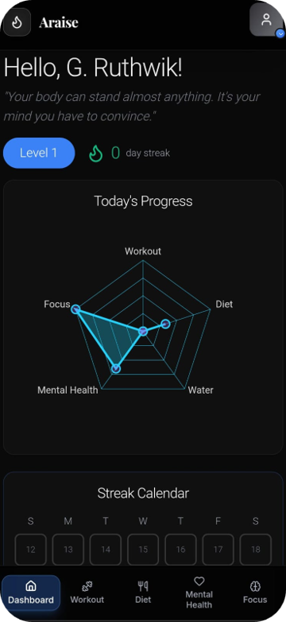
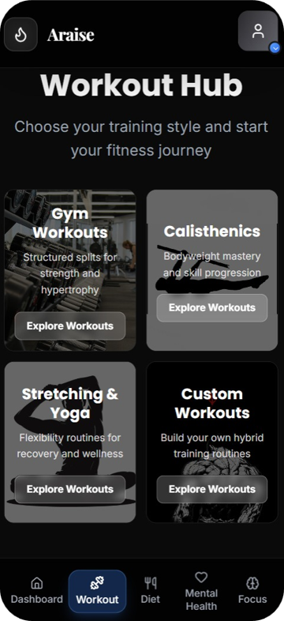
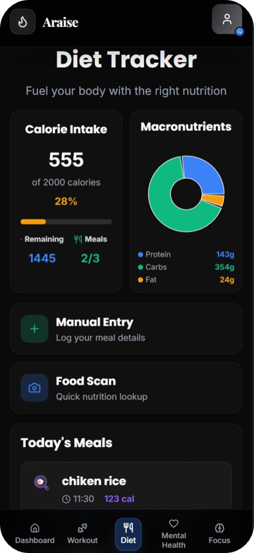
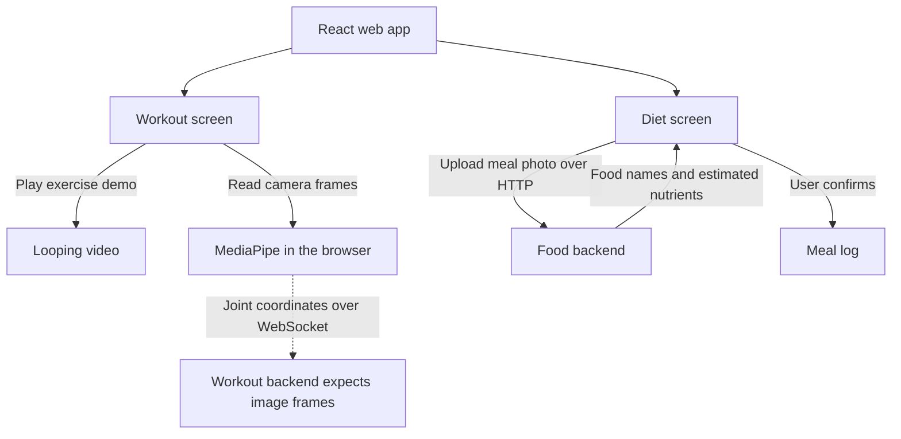

# ARAISE

ARAISE brings workouts, meals, water intake, and focus sessions into one daily dashboard. Choose a workout, log a meal or a drink, and use the activity history to review a particular day.

[Open the web app](https://arasie.vercel.app/)

## App screenshots

<table>
  <tr>
    <th>Home page</th>
    <th>Workout Hub</th>
    <th>Diet Tracker</th>
  </tr>
  <tr>
    <td align="center"><a href="docs/screenshots/homepage.png"></a></td>
    <td align="center"><a href="docs/screenshots/workouthub.png"></a></td>
    <td align="center"><a href="docs/screenshots/diettracker.png"></a></td>
  </tr>
</table>

## Features

| Area | What you can do |
| --- | --- |
| Workouts | Follow gym, calisthenics, or stretching and yoga plans. Build a custom session or use the camera for supported exercises. |
| Nutrition | Log meals, review calories and macronutrients, or upload a food photo for analysis. |
| Hydration | Record water intake and see progress toward your daily target. |
| Focus | Schedule tasks on the calendar and run timed focus sessions. |
| Mental wellness | Follow a guided breathing exercise, try a short meditation, or write a journal entry. |
| Activity history | Select a date to review workouts, meals, hydration, focus, and wellness activity together. |

## How workout media and food scanning work



**Workout media.** The workout screen loops a demonstration video when the exercise has one. In camera mode, MediaPipe tracks body landmarks in the browser. The dotted line marks a format mismatch at `/ws/{exercise}`. The frontend sends joint coordinates as JSON, while the linked Python backend reads base64-encoded images. With these versions, the camera can track movement locally, but the server skips those messages and the screen receives no rep count or form feedback from them.

**Food scanning.** The Diet screen uploads one meal photo to `POST /api/v1/food/analyze`. The food backend identifies foods and returns estimated calories, protein, carbohydrates, and fat. The screen previews the results. When the user adds the meal, it logs the first detected item's nutrition.

## Repositories

| Component | Role | Source |
| --- | --- | --- |
| Web app | React and Vite frontend with Firebase Authentication and Cloud Firestore | [Ruthwik000/Arasie](https://github.com/Ruthwik000/Arasie) |
| Workout backend | FastAPI service that uses MediaPipe and OpenCV to track curls, squats, push-ups, and plank holds | [Ruthwik000/araise_be](https://github.com/Ruthwik000/araise_be) |
| Food backend | Analyzes uploaded meal photos for the nutrition tracker | [Ruthwik000/food_araise](https://github.com/Ruthwik000/food_araise) |

## Run the web app locally

Use Node.js 22.12 or later and npm. From the repository root, install the frontend dependencies in `araise/`.

```sh
cd araise
npm ci
```

In Firebase, register a web app, create a Cloud Firestore database, and enable Email/Password or Google sign-in. Copy the web app configuration into `araise/.env.local` using these names.

```dotenv
VITE_FIREBASE_API_KEY=
VITE_FIREBASE_AUTH_DOMAIN=
VITE_FIREBASE_PROJECT_ID=
VITE_FIREBASE_STORAGE_BUCKET=
VITE_FIREBASE_MESSAGING_SENDER_ID=
VITE_FIREBASE_APP_ID=
VITE_FIREBASE_MEASUREMENT_ID=
```

Start the development server with `npm run dev`. Open the URL printed by Vite, usually `http://localhost:3000`. To build and preview the production bundle, run `npm run build` followed by `npm run preview`.

### Connect the backends

When the web app runs on localhost, the workout client connects to `ws://localhost:8000`. Food photo analysis also defaults to port 8000. To use both services locally, run the workout backend on port 8000 and the food backend on a different port, such as 8001. Set `VITE_FOOD_API_BASE_URL=http://localhost:8001` in `araise/.env.local` and restart Vite.

For a hosted frontend, `VITE_WS_HOST` selects the workout service hostname, and `VITE_FOOD_API_BASE_URL` selects the food service base URL.

## Credits and license

Built by [Ruthwik000](https://github.com/Ruthwik000), [PATTASWAMY-VISHWAK-YASASHREE](https://github.com/PATTASWAMY-VISHWAK-YASASHREE), and [vara-prasad-07](https://github.com/vara-prasad-07). Released under the [MIT License](./LICENSE).
